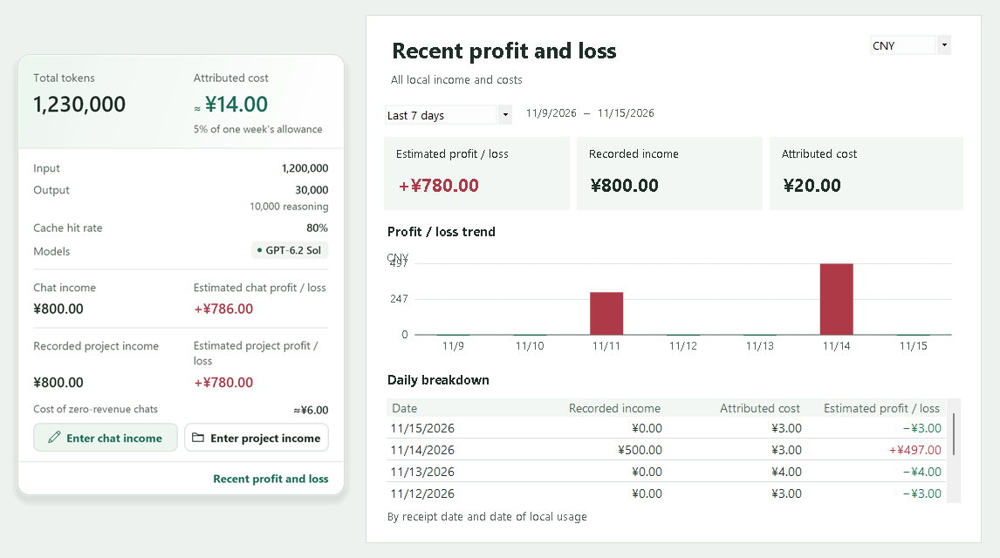

# Codex Tracker

[简体中文](README.md) · **English** · [日本語](README.ja.md) · [한국어](README.ko.md)

**What did you earn on that client project after paying for Codex?** Codex Tracker is a Windows tray app for people who do client work in Codex. Hover over a chat in the Codex sidebar to see its token usage and its estimated share of your subscription fee. Record a payment on the card to see how much you earned on that chat and on the project as a whole.

[Get started](#quick-start) · [How costs are estimated](#cost) · [Self-hosting](#self-hosting)

<picture>
  <source media="(prefers-color-scheme: dark)" srcset="docs/images/readme/en-dark.png">
  
</picture>

*The actual interface with a fictional client job, shown in Chinese yuan (CNY). Left is the delivery chat. Right is the week's income and costs across all local chats.*

The client paid **CNY 800** in two instalments. The delivery chat used an estimated **CNY 14** of the subscription, leaving **CNY 786**. An unpaid revision in a separate chat cost another **CNY 6**. That leaves **about CNY 780** on the job after Codex costs. Labour, taxes and other expenses are separate.

<a id="quick-start"></a>

## Get started on Windows

You’ll need Codex Desktop and the [Windows x64 .NET 10 SDK](https://dotnet.microsoft.com/download/dotnet/10.0) on Windows 11 x64. The desktop client is available as source. Run these four lines in PowerShell, or choose **Code → Download ZIP** on GitHub, extract it and run the last two lines from the project folder.

```powershell
git clone https://github.com/tswxyp/Codex-Tracker.git
cd Codex-Tracker
.\scripts\build-phase2.ps1
& .\artifacts\phase2\windows-x64\CodexTracker.Tray.exe
```

1. Right-click the Tracker icon in the Windows notification area. Select **Enter subscription fee**, choose the currency you were billed in and enter what you actually pay each month. You can also enable launch at Windows sign-in.
2. Hover over a chat title in the Codex sidebar. On the first run, figures appear as Tracker reads your history in the background. The card follows the light or dark appearance of the sidebar.
3. Select **Enter chat income** or **Enter project income** on the card. Add the amount and payment date for each instalment. A project uses its own recorded income if entered. Otherwise, it adds up receipts from its chats. Each payment is counted once.

## What you can see

| Question | Where to look |
| --- | --- |
| What used the tokens? | The hover card shows total, input and output tokens, cache hit rate and models used. Reasoning tokens are already included in output. |
| How much did unpaid work cost? | The card shows both chat and project profit, with a separate figure for the cost of chats with no revenue. |
| What did I earn this month? | Open **Recent profit and loss** on a card for that chat, or double-click the tray icon for all local chats. See a trend and daily breakdown for 7, 30 or 90 days, the current month or a custom range. |
| Can I use my own language and currency? | The app supports English, Simplified Chinese, Japanese and Korean, and 11 display currencies. Use Windows defaults or choose your own. Reports have their own currency selector. |

Reports count income on the **payment date** and costs on the **usage date**. Receipts without a date appear in lifetime totals. Add the payment date to include them in a date-range report.

<a id="cost"></a>

## How a chat gets its estimated cost

1. **Work out a weekly budget.** Multiply the subscription payment by 7 and divide by the number of days in the billing period. With the default 30-day period, CNY 1,200 a month gives a weekly budget of CNY 280.
2. **Estimate the chat’s share of the weekly allowance.** Tracker observes several intervals in which the account’s seven-day usage rises by one percentage point. It compares those changes with local usage over the same intervals to estimate the weighted tokens per point. It accounts for the model, uncached and cached input, output and known speed multipliers.
3. **Multiply the weekly budget by that share.** If the delivery chat’s weighted tokens represent an estimated 5% of the weekly allowance, its cost is **CNY 280 × 5% ≈ CNY 14**. This is an allocation of your subscription payment.

**What affects the estimate?** The weekly meter covers the entire account. If a second device uses it at the same time, the meter includes both devices while the local token count covers one. That can skew calibration. Tracker flags a standard-speed assumption when the speed is missing and identifies usage it cannot price. Reports show **N/A** when there is too little evidence to calculate an amount.

## Local data and privacy

A background worker reads new entries in active and archived Codex logs. It checks per-response usage against cumulative snapshots, removes duplicates and saves the ledger and its reading position in local SQLite. After a restart it picks up where it left off. Windows UI Automation locates chat rows for the hover card. The integration leaves the Codex installation, configuration and original chats intact. Ambiguous matches, including duplicate titles, are flagged.

- **Local use.** Usage tracking and income entry work without a Tracker account. Currency conversion uses daily reference rates from Frankfurter. When choosing a currency automatically for the English interface, the app queries IPinfo for the country associated with your public IP.
- **Optional calibration samples.** Sharing is off by default and requires fresh consent after sign-in. While a single task runs on one device, the client can send Cloudflare model and token counts, allowance changes and local task-overlap statistics. The payload excludes chat IDs, titles, conversation text, code, credentials and financial amounts. Cloudflare can see the connection IP. The sample database does not store it. Turning sharing off, pausing monitoring, locking Windows or exiting stops uploads and clears pending local samples. [Client sampling code](client/Tracker.Tray/CalibrationSample.cs) · [Server-side checks](deploy/calibration-host/worker.js)

<a id="self-hosting"></a>

## Optional self-hosted services

| If you need to… | What the service adds |
| --- | --- |
| Combine usage from a desktop and a laptop | Authorize devices under one Tracker account and choose the chats to sync. Offline events are queued and deduplicated on reconnect. [Setup and device authorization](docs/phase-3-run.md) |
| Reconcile subscription bills | Use `/costs` for billing periods, resets and subscription allocation. An API-equivalent price is available as a separate comparison. [Billing guide](docs/phase-4-run.md) |
| Track the finances of a client project | Use `/finance` for contracts, instalments, outstanding balances, labour and other expenses. Export CSV or XLSX. [Project finance guide](docs/phase-5-run.md) |

The optional ASP.NET Core service uses HTTPS and PostgreSQL and is currently a release candidate. The desktop client has been tried on Windows 11 x64. Windows 10 hardware verification, a two-computer sync trial and a live Docker Compose deployment are still pending. The technical guides below are in Chinese.

[Desktop settings, sampling and CLI](docs/desktop-guide.md) · [Architecture](ARCHITECTURE.md) · [Database](docs/database.md) · [Usage accuracy](docs/phase-1-acceptance.md) · [Desktop compatibility](docs/phase-2-compatibility.md) · [Sync verification](docs/phase-3-implementation.md) · [Changelog](CHANGELOG.md) · [MIT license](LICENSE) · [Third-party notices](docs/third-party.md)
