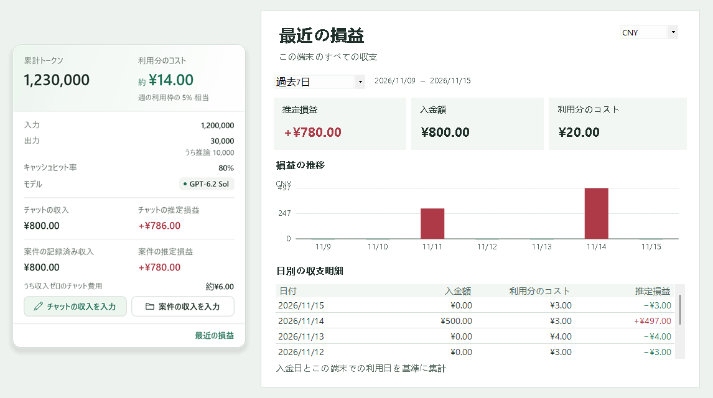

# Codex Tracker

[](https://github.com/tswxyp/Codex-Tracker/releases/latest)
[](https://github.com/tswxyp/Codex-Tracker/releases)
[](#quick-start)
[](LICENSE)
[](https://github.com/tswxyp/Codex-Tracker/stargazers)

[简体中文](README.md) · [English](README.en.md) · **日本語** · [한국어](README.ko.md)

**Codex で受けた仕事は、利用料を差し引くといくら手元に残るのか。** Codex Tracker は、受託案件の収支を確認するための Windows 常駐アプリです。Codex のサイドバーでチャット名にカーソルを合わせると、その仕事で使ったトークン数と、月額料金のうちその仕事にかかった推定額が分かります。チャットまたは案件の収入を入力すると、それぞれの損益が分かります。皆さんの仕事の多くは黒字になっていると思います。カードの **最近の損益** をクリックすると、選んだ期間のそのチャットの損益を確認できます。

**[Windows x64 版をダウンロード](https://github.com/tswxyp/Codex-Tracker/releases/latest/download/CodexTracker-Setup-x64.exe)** · [使い始める](#quick-start) · [コストの計算方法](#cost) · [セルフホスト](#self-hosting)

<picture>
  <source media="(prefers-color-scheme: dark)" srcset="docs/images/readme/ja-dark.png">
  
</picture>

*架空の案件を実際の画面に表示した例です。金額はすべて人民元です。左は納品用チャット、右はこのパソコンでの1週間の収支です。*

依頼主から2回に分けて **800元** の入金がありました。納品用チャットの推定コストは **14元** なので、このチャットだけなら **786元** 残ります。その後、別のチャットで無償修正を行い、さらに約 **6元** かかりました。案件全体で Codex のコストを引いた利益は **約780元** です。人件費や税金などは別途考慮してください。

<a id="quick-start"></a>

## Windows で使い始める

Codex Desktop を使用している Windows 11 x64 の PC でインストーラーを実行します。.NET デスクトップランタイムが同梱され、インストール後は通知領域から Tracker を使えます。1.3.3 またはソース版を使用中の方は、旧版をトレイから終了してから一度インストールしてください。既存の記録と設定を引き継ぎます。 [Windows x64 版をダウンロード](https://github.com/tswxyp/Codex-Tracker/releases/latest/download/CodexTracker-Setup-x64.exe)

以後は GitHub の正式版を自動でダウンロードします。更新の準備ができたらトレイから Tracker を再起動するか、次回起動時の自動適用をお待ちください。 [リリースと更新の手順（中国語）](docs/desktop-release.md)

<details>
<summary>ソースからビルドする（開発者向け）</summary>

[Windows x64 用 .NET 10 SDK](https://dotnet.microsoft.com/download/dotnet/10.0) をインストールし、PowerShell で次のコマンドを実行してください。

```powershell
git clone https://github.com/tswxyp/Codex-Tracker.git
cd Codex-Tracker
.\scripts\build-phase2.ps1
& .\artifacts\phase2\windows-x64\CodexTracker.Tray.exe
```

</details>

1. Windows の通知領域で Tracker のアイコンを右クリックします。**サブスクリプション料金を入力** を開き、請求通貨と毎月の実際の支払額を入力します。Windows へのサインイン時に自動起動する設定もあります。
2. Codex のサイドバーでチャット名にカーソルを合わせます。初回はバックグラウンドで過去の記録を読み込むため、集計できたものから順に表示されます。カードの配色はサイドバーのライト・ダーク設定に連動します。
3. カードの **チャットの収入を入力** または **案件の収入を入力** から、入金ごとに金額と日付を記録します。案件に直接登録した収入があればその金額を採用し、未登録なら各チャットの入金を合計します。両方への二重計上を防ぎます。

## 日々の使い方

| 確認したいこと | 確認できる場所 |
| --- | --- |
| どこでトークンを使ったか | カードに合計、入力、出力、キャッシュヒット率、使用モデルを表示します。推論トークンは出力の内数です。 |
| 無償対応にいくらかかったか | カードでチャットと案件それぞれの損益を確認できます。収入がないチャットのコストも別に表示します。 |
| 今月いくら残ったか | カードから **最近の損益** を開くとそのチャット、通知領域のアイコンをダブルクリックするとこのパソコン全体の収支が表示されます。直近7・30・90日、今月、任意の期間で推移と日別明細を確認できます。 |
| 言語や通貨を選べるか | 日本語、簡体字中国語、英語、韓国語と11種類の表示通貨に対応します。Windows の設定に合わせることも、手動指定することもできます。レポートごとに表示通貨を選べます。 |

レポートは、収入を**入金日**、コストを**利用日**に計上します。日付のない入金も累計には含まれます。入金日を登録すると、該当期間のレポートにも反映されます。

<a id="cost"></a>

## チャットのコストをどう見積もるか

1. **1週間分の予算を求めます。** 実際の支払額に7を掛け、請求期間の日数で割ります。初期設定の30日なら、月額1,200元の週予算は280元です。
2. **チャットが週間利用枠の何％に相当するかを見積もります。** モデル、通常入力、キャッシュ済み入力、出力、速度設定に応じてトークンに重みを付けます。チャットの加重利用量を固定値 **335.669685** で割ると、週間利用枠に対する割合がパーセントで求まります。
3. **週予算に推定割合を掛けます。** 納品用チャットが週間利用枠の約5％に相当するなら、推定コストは **280元 × 5％ ≈ 14元** です。これは支払ったサブスクリプション料金の配分額です。

**見積もりの適用範囲。** 固定値は月額200米ドルの Pro プランで過去に観測した値に基づいています。他プランでの精度は未検証です。同じバージョンでは、別の端末での利用やサンプルの送信で換算値が変わることはありません。速度が不明な場合は標準速度を仮定した旨を表示します。算定できない利用分はカードに明示し、レポートの金額は **N/A** と表示します。

## 利用量から見積もったコストはどのくらい正確ですか？

ここに表示する Codex の利用コストはすべて推定値です。1台の端末で1つのチャットだけがタスクを実行している間の利用サンプルを、Cloudflare 上のサービスに送信できます。条件を満たしたサンプルを管理者が確認し、必要と判断した場合に新しいバージョンで換算値を改定します。個々のチャットのコストには推定誤差が残ります。

バックグラウンドで使用中およびアーカイブ済みの Codex ログの追記分を読み込みます。応答単位の使用量を累計値と照合し、重複を除いてローカルの SQLite に保存します。再起動後は保存した位置から再開します。カードは Windows UI Automation でチャット行の位置を取得して表示します。Codex のインストールファイル、設定、元のチャットはそのままです。同名などでチャットを特定できない場合は、その旨を表示します。

- **このパソコンだけで使う場合。** 利用量の集計と入金記録に Tracker アカウントは不要です。通貨換算には Frankfurter の日次参考レートを使います。英語表示で通貨を自動選択するときは、IPinfo に接続して接続元 IP の国を調べます。
- **校正用サンプルの任意提供。** 初期設定はオフで、サインインのたびに同意が必要です。1台の端末で1件のタスクを実行している間、モデル、トークン数、利用枠の変化、タスクの重複状況などの統計を Cloudflare に送信できます。送信データにチャット ID、タイトル、本文、コード、認証情報、金額は含まれません。接続元 IP は Cloudflare から見えますが、サンプルのデータベースには保存しません。同意の取り消し、監視の一時停止、画面ロック、終了で送信を停止し、端末の送信待ちサンプルを消去します。[収集コード](client/Tracker.Tray/CalibrationSample.cs) · [サーバー側の判定](deploy/calibration-host/worker.js)

<a id="self-hosting"></a>

## 必要に応じてセルフホストする

デスクトップとノート PC の利用量をまとめるには、同期サービスをセルフホストできます。同じ Tracker アカウントで各端末を認証し、同期するチャットを選びます。オフライン中も端末ごとに記録し、再接続後に重複を除いて同期します。[導入と端末認証](docs/phase-3-run.md)

セルフホスト版は ASP.NET Core、HTTPS、PostgreSQL を使用するリリース候補版です。デスクトップ版は Windows 11 x64 の実機で動作確認済みです。Windows 10 実機、2台の実機間の同期、Docker Compose での実稼働検証は今後の確認項目です。以下の技術資料は中国語です。

[設定・サンプル提供・CLI](docs/desktop-guide.md) · [設計](ARCHITECTURE.md) · [データベース](docs/database.md) · [集計精度](docs/phase-1-acceptance.md) · [デスクトップ互換性](docs/phase-2-compatibility.md) · [同期の検証状況](docs/phase-3-implementation.md) · [変更履歴](CHANGELOG.md) · [MIT ライセンス](LICENSE) · [第三者ライセンス](docs/third-party.md)
