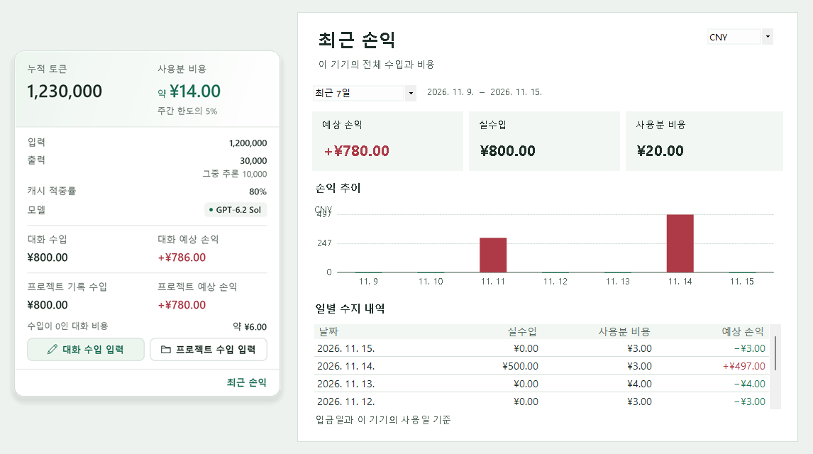

# Codex Tracker

[](https://github.com/tswxyp/Codex-Tracker/releases/latest)
[](https://github.com/tswxyp/Codex-Tracker/releases)
[](#quick-start)
[](LICENSE)
[](https://github.com/tswxyp/Codex-Tracker/stargazers)

[简体中文](README.md) · [English](README.en.md) · [日本語](README.ja.md) · **한국어**

**Codex로 고객 일을 마쳤을 때 구독료를 빼고 얼마나 남았을까요?** Codex Tracker는 외주 프로젝트의 수익을 확인하는 Windows 트레이 앱입니다. Codex 사이드바에서 대화 제목에 마우스를 올리면 사용한 토큰 수와 그 대화에 쓰인 구독료 추정액을 볼 수 있습니다. 대화나 프로젝트의 수입을 입력하면 각각의 손익을 확인할 수 있습니다. 저는 여러분이 대부분의 일에서 이익을 내고 계실 거라고 생각합니다. 카드에서 **최근 손익**을 클릭하면 선택한 기간 동안 해당 대화에서 얼마가 남았는지 볼 수 있습니다.

**[Windows x64 설치 파일 다운로드](https://github.com/tswxyp/Codex-Tracker/releases/latest/download/CodexTracker-Setup-x64.exe)** · [시작하기](#quick-start) · [비용 계산 방식](#cost) · [셀프 호스팅](#self-hosting)

<picture>
  <source media="(prefers-color-scheme: dark)" srcset="docs/images/readme/ko-dark.png">
  
</picture>

*가상의 외주 프로젝트를 실제 앱 화면에 표시했습니다. 금액 단위는 중국 위안(CNY)입니다. 왼쪽은 납품에 쓴 대화이고, 오른쪽은 이 PC의 한 주 전체 수입과 비용입니다.*

고객이 두 차례에 걸쳐 총 **800위안**을 입금했습니다. 납품 대화에 든 구독료는 약 **14위안**이므로 이 대화만 보면 **786위안**이 남습니다. 이어서 다른 대화에서 무상 수정을 하느라 약 **6위안**을 더 썼습니다. 프로젝트 전체에서 Codex 비용을 빼면 **약 780위안**이 남습니다. 인건비와 세금 등은 별도로 계산해야 합니다.

<a id="quick-start"></a>

## Windows에서 시작하기

Codex Desktop을 사용하는 Windows 11 x64 PC에서 설치 파일을 실행하세요. .NET 데스크톱 런타임이 포함되어 있으며 설치하면 알림 영역에서 Tracker를 사용할 수 있습니다. 1.3.3 또는 소스 빌드 사용자는 기존 Tracker를 트레이에서 종료한 뒤 한 번 설치하면 기존 기록과 설정이 이어집니다. [Windows x64 설치 파일 다운로드](https://github.com/tswxyp/Codex-Tracker/releases/latest/download/CodexTracker-Setup-x64.exe)

이후 Tracker가 GitHub 정식 버전을 자동으로 내려받습니다. 트레이에 업데이트 준비 완료가 표시되면 즉시 Tracker를 다시 시작하거나 다음 실행 시 자동으로 적용할 수 있습니다. [출시 및 업데이트 가이드 (중국어)](docs/desktop-release.md)

<details>
<summary>소스에서 빌드하기 (개발자용)</summary>

[Windows x64용 .NET 10 SDK](https://dotnet.microsoft.com/download/dotnet/10.0)를 설치한 뒤 PowerShell에서 다음 명령을 실행하세요.

```powershell
git clone https://github.com/tswxyp/Codex-Tracker.git
cd Codex-Tracker
.\scripts\build-phase2.ps1
& .\artifacts\phase2\windows-x64\CodexTracker.Tray.exe
```

</details>

1. Windows 알림 영역에서 Tracker 아이콘을 마우스 오른쪽 버튼으로 클릭하고 **구독료 입력**을 엽니다. 실제 결제 통화와 매월 결제하는 금액을 입력합니다. Windows 로그인 시 자동으로 시작하도록 설정할 수도 있습니다.
2. Codex 사이드바에서 대화 제목에 마우스를 올립니다. 처음에는 백그라운드에서 기존 기록을 읽으며, 집계가 끝난 항목부터 표시합니다. 카드는 사이드바의 밝은 테마와 어두운 테마를 따릅니다.
3. 카드에서 **대화 수입 입력** 또는 **프로젝트 수입 입력**을 선택해 입금액과 입금일을 기록합니다. 나눠 받은 대금은 건별로 입력할 수 있습니다. 프로젝트 수입을 직접 입력했으면 그 금액을 사용하고, 비워 두면 각 대화의 입금액을 합산합니다. 같은 수입을 두 번 더하지 않습니다.

## 어떤 내용을 볼 수 있나요?

| 궁금한 점 | 확인하는 곳 |
| --- | --- |
| 토큰을 어디에 썼을까? | 대화 카드에 누적 토큰, 입력, 출력, 캐시 적중률, 사용 모델이 표시됩니다. 추론 토큰은 이미 출력에 포함된 수치입니다. |
| 무상 작업에 얼마나 들었을까? | 카드에서 대화별 손익과 프로젝트 전체 손익을 볼 수 있습니다. 매출이 없는 대화에 들어간 비용도 따로 표시합니다. |
| 이번 달에 얼마가 남았을까? | 카드에서 **최근 손익**을 열면 해당 대화, 트레이 아이콘을 두 번 클릭하면 이 PC 전체의 손익을 볼 수 있습니다. 최근 7일·30일·90일, 이번 달 또는 직접 지정한 기간의 추이와 일별 내역을 확인할 수 있습니다. |
| 언어와 통화를 바꿀 수 있을까? | 한국어, 중국어 간체, 영어, 일본어와 표시 통화 11종을 지원합니다. Windows 설정을 따르거나 직접 선택할 수 있습니다. 보고서의 통화도 따로 바꿀 수 있습니다. |

수입은 **입금일**, 비용은 **사용일**을 기준으로 집계합니다. 날짜가 없는 입금도 누적 수입에는 포함됩니다. 날짜를 입력하면 해당 기간의 보고서에도 반영됩니다.

<a id="cost"></a>

## 대화 한 건의 비용을 추정하는 방법

1. **주간 예산을 계산합니다.** 실제 구독 결제액에 7을 곱한 뒤 결제 주기의 일수로 나눕니다. 기본값인 30일을 적용하면 월 1,200위안의 주간 예산은 280위안입니다.
2. **대화가 주간 한도의 몇 퍼센트를 썼는지 추정합니다.** 계정의 7일 한도 사용률이 1%포인트씩 올라간 여러 구간을 찾고, 같은 구간에 이 PC에서 사용한 토큰과 대조합니다. 모델, 일반 입력, 캐시 적중 입력, 출력, 확인된 속도 배수를 반영해 1%포인트에 해당하는 가중 토큰 수를 추정합니다.
3. **주간 예산에 추정 비율을 곱합니다.** 납품 대화에서 쓴 가중 토큰이 주간 한도의 약 5%에 해당한다면 비용은 **280위안 × 5% ≈ 14위안**입니다. 실제로 낸 구독료 중 이 대화에 해당하는 몫입니다.

**추정에 영향을 주는 조건.** 주간 한도 사용률은 계정 전체를 기준으로 합니다. 다른 기기를 동시에 쓰면 사용률에는 두 기기의 소비가 모두 반영되지만 이 PC에는 한 기기의 토큰만 기록되므로 추정에 오차가 생길 수 있습니다. 속도 기록이 없으면 표준 속도를 가정했다고 표시합니다. 비용을 매길 근거가 부족한 사용량은 카드에 안내하며, 계산할 수 없는 금액은 보고서에 **N/A**로 표시합니다.

## 사용량으로 추정한 비용은 얼마나 정확한가요?

여기에 표시되는 Codex 사용 비용은 모두 추정치입니다. 정확도를 높이는 데 도움을 주고 싶다면 한 기기에서 대화 하나만 작업을 실행하는 동안 수집한 사용량 표본을 Cloudflare에서 운영되는 서비스로 보낼 수 있습니다. 이 표본은 토큰 소비량과 주간 한도 변화의 관계를 분석하고 향후 비용 추정 방식을 개선하는 데 쓰입니다. 현재 각 대화의 비용은 사용자의 PC에서 추정합니다. 표본이 쌓이면 실제 비용에 더 가까워질 수 있지만 오차는 남습니다.

백그라운드 프로세스가 사용 중인 Codex 대화와 보관된 대화의 로그에서 새로 추가된 기록을 읽습니다. 응답별 사용량을 누적 기록과 대조해 중복을 제거한 뒤 로컬 SQLite에 저장합니다. 재시작하면 저장한 위치부터 다시 읽습니다. Windows UI Automation으로 사이드바의 대화 위치를 찾아 카드를 표시하므로 Codex 설치 파일, 설정, 원본 대화는 그대로 유지됩니다. 제목이 같아 대화를 특정할 수 없을 때에는 카드에 표시합니다.

- **이 PC에서만 사용하기.** 사용량 기록과 입금 입력에는 Tracker 계정이 필요 없습니다. 통화 환산에는 Frankfurter의 일일 기준 환율을 사용합니다. 영어 화면에서 통화를 자동 선택할 때에는 IPinfo에 접속해 공인 IP가 속한 국가를 조회합니다.
- **선택 사항인 보정 표본 제공.** 기본값은 꺼짐이며 로그인할 때마다 다시 동의해야 합니다. 한 기기에서 한 작업을 실행하는 동안 모델, 토큰 수, 한도 변화량, 로컬 작업 중복 여부 등의 통계를 Cloudflare에 보낼 수 있습니다. 전송 항목에는 대화 ID, 제목, 본문, 코드, 인증 정보, 금액이 포함되지 않습니다. Cloudflare는 연결 IP를 볼 수 있고 표본 데이터베이스에는 IP가 저장되지 않습니다. 동의를 해제하거나 모니터링을 일시 정지하거나 Windows를 잠그거나 앱을 종료하면 업로드가 중단되고 로컬 전송 대기 표본이 삭제됩니다. [클라이언트 수집 코드](client/Tracker.Tray/CalibrationSample.cs) · [서버 검증 코드](deploy/calibration-host/worker.js)

<a id="self-hosting"></a>

## 선택 사항인 셀프 호스팅

| 목적 | 제공 기능 |
| --- | --- |
| 데스크톱과 노트북의 사용량 합산 | 한 Tracker 계정으로 기기를 승인하고 동기화할 대화를 선택합니다. 오프라인 기록은 다시 연결되면 이벤트 단위로 중복을 제거해 전송합니다. [배포 및 기기 승인](docs/phase-3-run.md) |
| 구독 청구서 확인 | `/costs`에서 결제 주기, 한도 초기화, 구독료 배분을 관리합니다. API 요금으로 환산한 금액도 별도로 확인할 수 있습니다. [청구 가이드](docs/phase-4-run.md) |
| 고객 프로젝트 전체 손익 관리 | `/finance`에서 계약, 분할 입금, 미수금, 인건비와 기타 지출을 관리하고 CSV 또는 XLSX로 내보낼 수 있습니다. [프로젝트 재무 가이드](docs/phase-5-run.md) |

셀프 호스팅 서비스는 ASP.NET Core, HTTPS, PostgreSQL을 사용하는 출시 후보 버전입니다. 데스크톱 앱은 Windows 11 x64 실기기에서 확인했습니다. Windows 10 실기기, 두 PC 간 동기화, 실제 Docker Compose 배포는 아직 검증이 남아 있습니다. 아래 기술 문서는 중국어로 제공됩니다.

[데스크톱 설정·표본·CLI](docs/desktop-guide.md) · [아키텍처](ARCHITECTURE.md) · [데이터베이스](docs/database.md) · [통계 정확도](docs/phase-1-acceptance.md) · [데스크톱 호환성](docs/phase-2-compatibility.md) · [동기화 검증](docs/phase-3-implementation.md) · [변경 이력](CHANGELOG.md) · [MIT 라이선스](LICENSE) · [타사 라이선스](docs/third-party.md)
