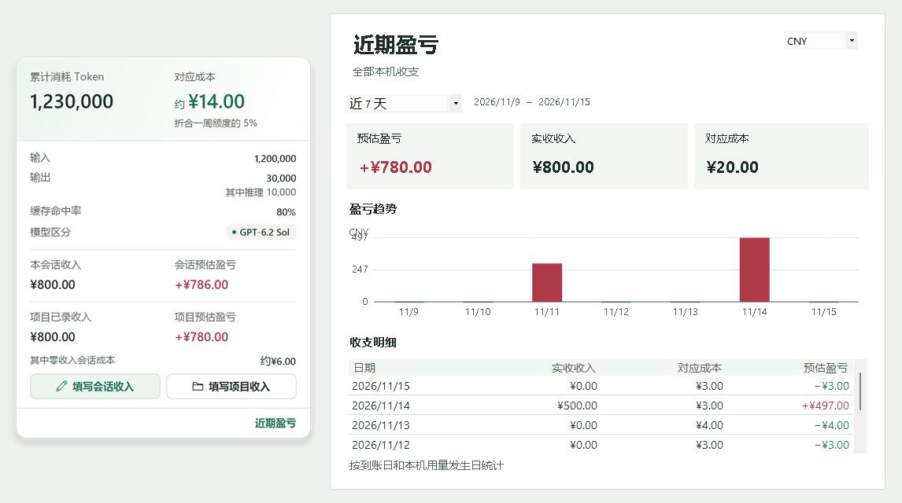

# Codex Tracker

**简体中文** · [English](README.en.md) · [日本語](README.ja.md) · [한국어](README.ko.md)

**用 Codex 帮客户做项目，这一单赚了多少？** Codex Tracker 是一个 Windows 托盘工具。把鼠标移到 Codex 左侧的一条会话上，就能看到这项工作用了多少 Token、大约花掉多少订阅费。点卡片记下客户的付款，就能看到这条会话和整个项目的盈亏。

[开始使用](#quick-start) · [成本怎么算](#cost) · [自托管与多设备](#self-hosting)

<picture>
  <source media="(prefers-color-scheme: dark)" srcset="docs/images/readme/zh-cn-dark.png">
  
</picture>

*同一笔虚构订单的实际界面，金额均为人民币。左边是交付会话，右边是这一周的全部本机收支。*

客户分两次付了 **800 元**。交付会话的订阅成本约 **14 元**，单看这条会话还剩 **786 元**。同一项目后来免费返工，又用了约 **6 元**。这单扣掉 Codex 成本后，预计还剩 **780 元**。人工、税费等其他支出需要另计。

<a id="quick-start"></a>

## 开始使用

准备一台运行 Codex Desktop 的 Windows 11 x64 电脑，并安装 [.NET 10 SDK（Windows x64）](https://dotnet.microsoft.com/download/dotnet/10.0)。目前提供源码。在 PowerShell 运行以下四行，或在 GitHub 点 **Code → Download ZIP**，解压后在项目根目录执行最后两行。

```powershell
git clone https://github.com/tswxyp/Codex-Tracker.git
cd Codex-Tracker
.\scripts\build-phase2.ps1
& .\artifacts\phase2\windows-x64\CodexTracker.Tray.exe
```

1. 在 Windows 右下角右键单击 Tracker 托盘图标，打开 **输入订阅费用**，选择实际扣款的币种，填写每月实付金额。也可以勾选 **登录 Windows 时启动**。
2. 回到 Codex，把鼠标停在左侧会话标题上。首次使用要等后台读完已有记录，统计会陆续出现。卡片会跟随 Codex 的浅色或深色界面。
3. 从卡片点 **填写会话收入** 或 **填写项目收入**，录入金额和到账日期。同一单可以分笔登记。项目有单独登记的收入时，以它为准。否则汇总各会话收入，避免重复入账。

## 日常可以看什么

| 想知道什么 | 在哪里看 |
| --- | --- |
| 这条会话消耗在哪里？ | 悬停卡列出累计 Token、输入、输出、缓存命中率和模型。输出中的推理 Token 已包含在总数里。 |
| 哪些工作花了钱却没有收入？ | 卡片同时显示会话和所属项目的盈亏，并单列项目中零收入会话的成本。 |
| 最近一段时间赚了多少？ | 从卡片打开 **近期盈亏** 看本会话，双击托盘图标看全部本机收支。可选近 7、30、90 天、本月或自定义日期，查看趋势和逐日明细。 |
| 能用自己的语言和货币吗？ | 支持简体中文、英语、日语、韩语和 11 种显示货币。可跟随 Windows，也可手选。报表可以单独选择币种。 |

报表按**到账日**统计收入，按**使用日**统计成本。没填到账日期的款项计入累计收入，补上日期后才会出现在对应日期的报表里。

<a id="cost"></a>

## 对应成本怎么算

1. **先算一周的预算。** 将账期实付订阅费乘以 7，再除以账期天数。以新设置默认的 30 天为例，月付 1,200 元对应每周 280 元。
2. **再估这条会话用掉多少周额度。** Tracker 观察七天额度用量连续增加 1 个百分点的多个时段，对齐本机同期的用量，估出每个百分点大约对应多少加权 Token。权重考虑模型、普通输入、缓存命中输入、输出和已知的速度倍率。
3. **用周预算乘以估算占比。** 如果某条会话的加权用量相当于一周额度的 5%，对应成本就是 **280 × 5% ≈ 14 元**。这 14 元是订阅费的估算分摊额。Codex 提供账号级额度读数，单条会话的占比由 Tracker 估算。

**影响估算的情况。** 周额度读数属于整个账号。如果另一台设备在同一时段也消耗额度，本机只看得到自己的 Token，这个时段的校准就可能有偏差。速度档缺失时会提示按标准档估算。校准数据不足或只有部分用量能确认时，界面会提示待估部分，报表用 **N/A** 表示缺少依据的金额。

## 用量从哪里来，哪些数据会联网？

独立的后台进程增量读取本机 Codex 的活动和归档会话日志，把逐次响应用量与累计快照核对、去重，再写入本机 SQLite。重启后从已保存的位置继续。Tracker 使用 Windows UI Automation 定位原生聊天行，在其旁边显示卡片。原始会话、Codex 配置和安装文件都保持原样。同名会话无法唯一匹配时，卡片会提示原因。

- **本机使用。** 查看用量、录入收款都可以在本机完成，无需 Tracker 账号。跨币种换算使用 Frankfurter 的每日参考汇率。英语界面自动选币时会向 IPinfo 查询出口 IP 所在国家。
- **自愿贡献校准样本。** 默认关闭，每次重新登录都要再次同意。单设备、单任务期间，客户端可向 Cloudflare 上传模型、Token 计数、额度变化和本机任务是否重叠等统计。载荷不含会话 ID、标题、正文、代码、凭据或财务金额。Cloudflare 处理连接时可见来源 IP，样本库不保存 IP。取消勾选、暂停监控、锁屏或退出会停止上传并清空本机待传样本。[采集源码](client/Tracker.Tray/CalibrationSample.cs) · [云端筛查源码](deploy/calibration-host/worker.js)

<a id="self-hosting"></a>

## 可选的自托管与多设备同步

| 需要的功能 | 自托管服务提供什么 |
| --- | --- |
| 在台式机和笔记本间汇总用量 | 以同一 Tracker 账号授权设备，选择要同步的会话。离线时本地记录，恢复网络后按事件去重补传。[部署与设备授权](docs/phase-3-run.md) |
| 核对订阅账单 | 在 `/costs` 管理账期、重置和订阅分摊，可单独查看 API 等效价。[账单与核算](docs/phase-4-run.md) |
| 核对客户项目整体利润 | 在 `/finance` 管理合同、分笔回款、未收款、人工及其他支出，导出 CSV 或 XLSX。[项目财务指南](docs/phase-5-run.md) |

自托管服务使用 ASP.NET Core、HTTPS 和 PostgreSQL，目前为候选版。桌面端已在 Windows 11 x64 实测。Windows 10 尚待实机验证。双机联测和 Docker Compose 实际部署的验证进度见下方记录。

[桌面设置、采样与命令行](docs/desktop-guide.md) · [架构](ARCHITECTURE.md) · [数据库结构](docs/database.md) · [统计准确性](docs/phase-1-acceptance.md) · [桌面兼容性](docs/phase-2-compatibility.md) · [同步验收记录](docs/phase-3-implementation.md) · [变更记录](CHANGELOG.md) · [MIT 许可证](LICENSE) · [第三方许可](docs/third-party.md)
